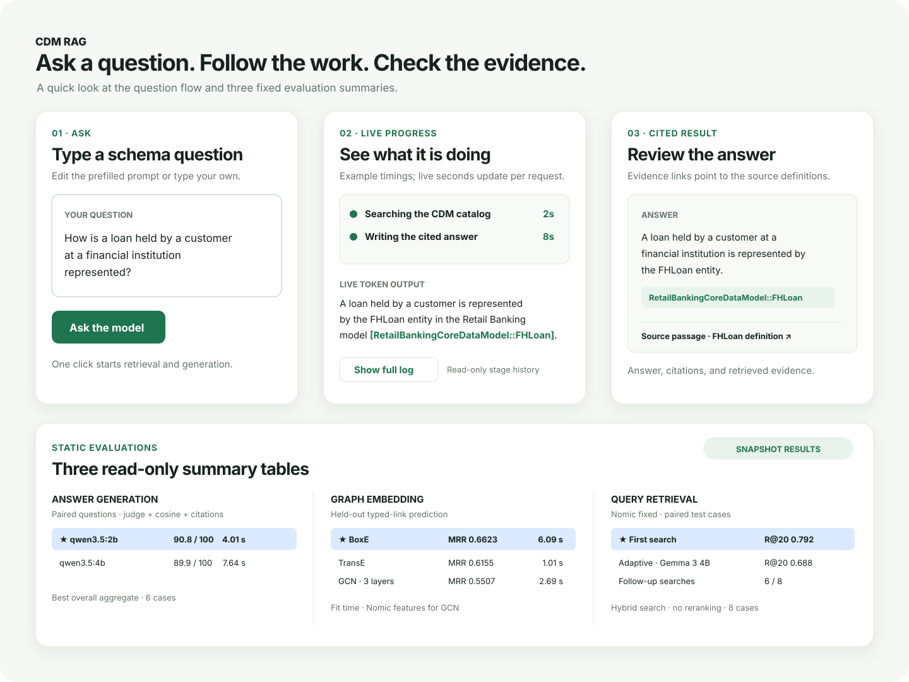
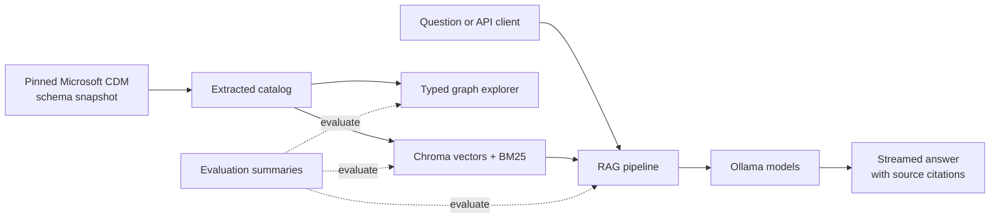

# CDM RAG

Ask questions about Microsoft's Common Data Model and explore its structure. This local demonstration retrieves source-linked schema passages from a pinned CDM catalog, generates cited answers with Ollama, and provides an interactive graph and evaluation summaries. The bundled catalog covers the Retail Banking model and common definitions; it is schema documentation, not customer or account data. See the [third-party data notice](THIRD_PARTY_NOTICES.md) for attribution and license details.





## Start locally

Install [uv](https://docs.astral.sh/uv/) and [Ollama](https://ollama.com/), start Ollama, and download the example models:

```sh
ollama pull qwen3-embedding:0.6b
ollama pull qwen3:4b
cp .env.example .env   # first setup only
uv sync
./scripts/run_local.sh
```

The first start builds a persistent index from the bundled catalog; subsequent starts reuse it. The local launcher listens on `127.0.0.1:8124`, and API token authentication is disabled by default in this profile. Keep it private; use a secured deployment such as the [independent GPU Compose](deploy/independent-gpu/README.md) profile for hosted access.

| Page | Purpose |
| --- | --- |
| [Home](http://localhost:8124/home) | Learn what CDM RAG does and choose where to go next. |
| [RAG assistant](http://localhost:8124/RAG) | Ask schema questions, stream a cited answer, and inspect its evidence. |
| [Graph explorer](http://localhost:8124/graph) | Search and navigate entities, attributes, traits, manifests, and relationships. |
| [Evaluations](http://localhost:8124/benchmarks) | View the answer, embedding, retrieval, and routing evaluations. |
| [Documentation](http://localhost:8124/docs) | Open the design overview, API reference, and MCP guide. |
| [API reference](http://localhost:8124/docs/api) | Explore the generated OpenAPI documentation. |

To call the API directly:

```sh
curl -X POST http://localhost:8124/api/v1/query \
  -H 'Content-Type: application/json' \
  -d '{"question":"What are the core attributes of the Account entity?"}'
```

To check a token for the independent GPU API without sending a question, run
this from the checkout with a private `.env` containing the GPU host and token:

```sh
python3 scripts/check_api_token.py --env-file .env
```

The file can contain `CDM_RAG_GPU_PUBLIC_HOST` and
`CDM_RAG_GPU_INITIAL_API_TOKEN`, or `CDM_RAG_API_TOKEN` for a different token.
Environment variables override the file. The command validates HTTPS, checks
`/api/v1/status`, and never prints the token. See the [independent deployment
guide](deploy/independent-gpu/README.md#checking-an-api-token) for options and
exit codes.

To ask the GPU service a question from the terminal using the same environment
file, run one of the following from this repository:

```sh
python3 scripts/ask_cdm.py --env-file .env \
  'What does FIOverdraft describe?'

python3 scripts/ask_cdm.py --env-file .env \
  'A bank needs the schema links from a person or company to something they own and onward to its specific loan or investment type. Which links establish this chain?'
```

The client shows live stages and model calls on stderr, then prints the final
answer on stdout. Add `--json` for the full response, sources, and processing
metadata on stdout; for a complete example see the [GPU API guide](docs/gpu-api.md).
It uses HTTPS, does not print the token or follow redirects,
and allows 600 seconds of connection inactivity by default; use `--timeout` to
change that. Model loading and inference may take a few minutes. See the
[streaming API guide](docs/api-streaming.md) for event and timing details.
The multi-hop question is an evaluation challenge, and its links should be
checked against the cited sources. Questions and answers are saved in the
service's query log, as with the web application.

## MCP clients

CDM RAG provides a first-party Model Context Protocol server with two read-only
tools: `ask_schema_question` and `service_status`. A local MCP client can start
the server over stdio with `uv run python -m app.mcp_stdio`. For the independent GPU
deployment, clients can also connect directly using Streamable HTTP at
`https://cdm-rag.example.com/api/v1/mcp/` (replace the hostname with your service host) with a CDM RAG API bearer token.

The [MCP setup guide](docs/mcp.md) includes local and hosted client examples,
credential handling, and tool limitations. The hosted endpoint uses an
existing, manually provisioned API token; it does not provide OAuth discovery.

## Run the tests

From the repository root, install the test dependencies and run the suite:

```sh
uv sync --frozen --extra test
uv run pytest -ra
```

The suite covers catalog retrieval, graph relationships, citations, routing,
API and MCP behavior, authentication and the terminal clients. Most tests use
fixtures or simulated model responses, so they do not need a running GPU or
Ollama. See the [testing guide](docs/testing.md) for focused commands, optional
prerequisites and the distinction between tests and quality evaluations.

## Documentation

| Guide | What you will find |
| --- | --- |
| [RAG pipeline](docs/rag/README.md) | Catalog ingestion, retrieval, model calls, citations, streaming, and configuration. |
| [Graph visualization](docs/graph/README.md) | Navigation, graph layers and filters, layout, clustering, and data limitations. |
| [MCP setup](docs/mcp.md) | Connect local or hosted MCP clients, authenticate, and discover the available tools. |
| [GPU API from a terminal](docs/gpu-api.md) | Check a token, ask easy and multi-hop questions, and inspect sources and processing metadata. |
| [Testing](docs/testing.md) | Run the suite and explore coverage of the API, retrieval, graph and access controls. |
| [Evaluation guide](docs/benchmarking/README.md) | Answer, embedding, retrieval, and routing evaluation, metrics, saved runs, and limitations. |
| [MacStudio handoff](docs/macstudio-handoff.md) | Reproduce the evidence-informed retrieval comparison with larger local models. |
| [Architecture](docs/architecture.md) | Components, data flows, persistence, and API endpoints. |
| [Extended reference](docs/reference.md) | Configuration details, provenance, and historical evaluation notes. |
| [Evaluation reports](evaluation/) | Datasets, experiment notes, and recorded results. |

The evaluation pages show fixed snapshots, not live rankings. The retrieval evaluation compares a first search with an experimental router that can request another search after inspecting the results; that follow-up experiment is not enabled for normal questions. Separately, the optional evidence-aware decision router can inspect an initial search before deciding whether to search as written, rewrite, or stop. The small, provisional evaluation sets do not establish universal model winners. Query and evaluation logs are saved on disk under `data/` by default; model settings can be changed from the app and apply to API clients as well.
