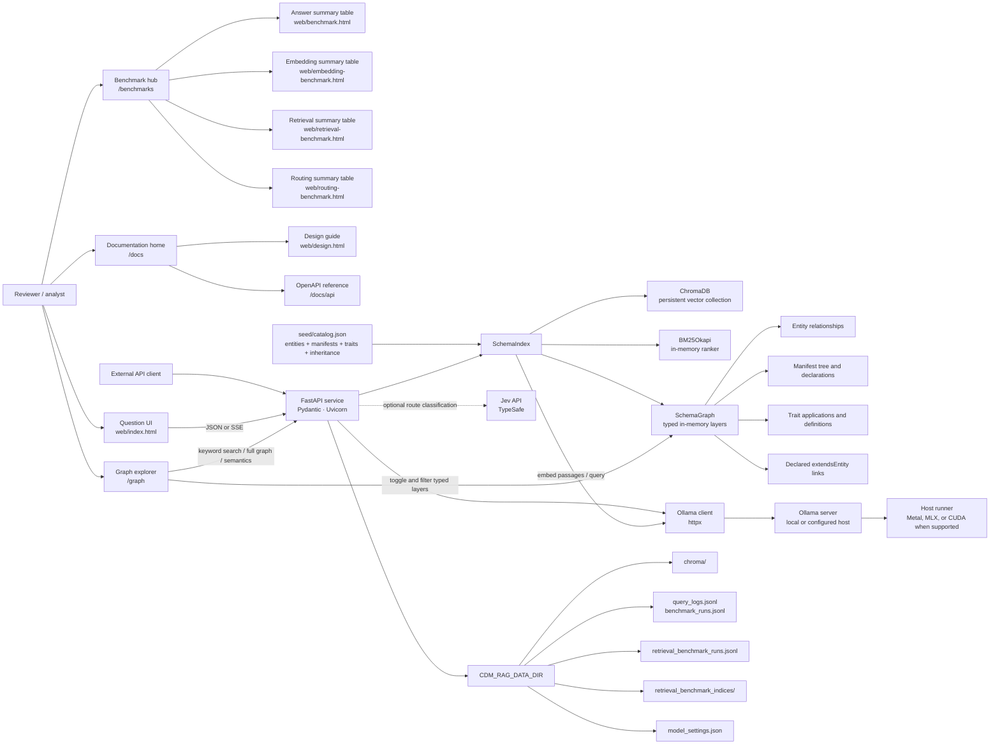
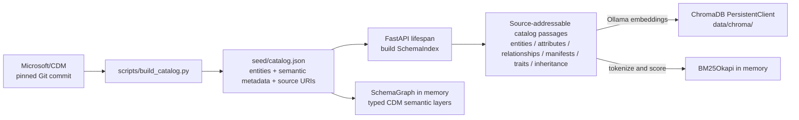
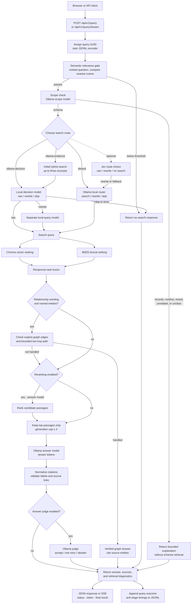
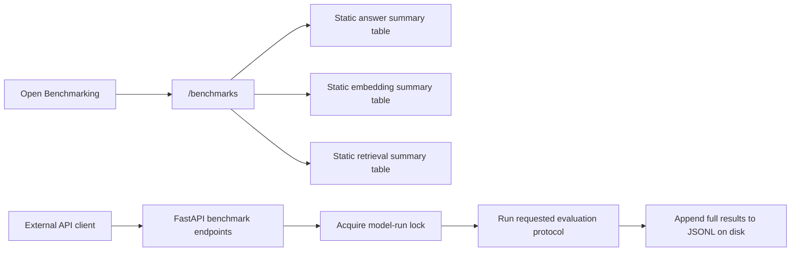
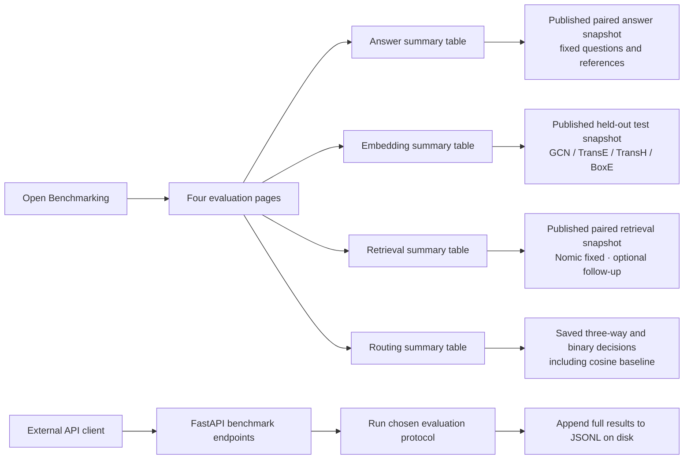

# CDM RAG architecture

This guide follows the running application in `app/`. It describes the current
implementation, including the optional routing and answer-review paths. The
diagrams are Mermaid, so GitHub renders them in this page.

For focused explanations, see the [RAG pipeline](rag/README.md), [graph explorer](graph/README.md), and [benchmarking](benchmarking/README.md) guides. The [main README](../README.md) provides setup and navigation.

## Components and tools

| Component | Tool used | What it does |
| --- | --- | --- |
| Question UI | Plain HTML, CSS, and JavaScript in [`web/index.html`](../web/index.html) | Sends a question, shows server-sent progress and tokens, and renders source links. |
| Graph explorer | Plain HTML, SVG, CSS, and JavaScript in [`web/graph.html`](../web/graph.html), backed by the in-memory `SchemaGraph` | Searches entity, attribute, and relationship keywords; cycles through matches on one infinite-hop canvas. The legend toggles entities, relationships, manifests, traits, inheritance, inferred groups, and node details. Searchable trait and group filters control individual items. Entity positions reuse the full graph’s cosine-embedding layout; typed CDM nodes and links are overlaid in the same space. Search and focus state are transient in the current page and no session history is written. |
| Benchmark hub | Static HTML and CSS in [`web/benchmarks.html`](../web/benchmarks.html) | Links to fixed answer generation, held-out graph link prediction, retrieval, and routing evaluations. |
| Answer benchmark summary | Static table in [`web/benchmark.html`](../web/benchmark.html) | Presents a paired answer-model snapshot with aggregate score, cosine, cited-entity F1, judge score, latency, and peak memory. |
| Embedding evaluation summary | Static table in [`web/embedding-benchmark.html`](../web/embedding-benchmark.html) | Presents GCN, TransE, TransH, and BoxE on held-out typed-graph link prediction, including filtered ranking metrics, fit times, and GCN feature preparation. It uses no questions. |
| Retrieval evaluation summary | Static table in [`web/retrieval-benchmark.html`](../web/retrieval-benchmark.html) | Compares a first search with an experimental evidence-informed follow-up on the same questions and index, with quality and timing metrics. |
| Routing evaluation summary | HTML and saved snapshots in [`web/routing-benchmark.html`](../web/routing-benchmark.html) | Compares search/rewrite/skip decisions, question-only and evidence-aware routers, and a no-LLM cosine gate; links to per-case outputs. |
| Documentation home and design guide | Plain HTML in [`web/documentation.html`](../web/documentation.html) and [`web/design.html`](../web/design.html) | Provides a concise overview, the component diagram, and links to the API reference. |
| API reference | FastAPI-generated OpenAPI at `/docs/api` | Presents request and response schemas from Pydantic models and route declarations in [`app/main.py`](../app/main.py). |
| HTTP API | FastAPI, Pydantic, and Uvicorn in [`app/main.py`](../app/main.py) | Validates requests, serves the pages and API, assigns query IDs, and coordinates model-intensive work. |
| CDM catalog | Pinned Microsoft CDM JSON definitions and [`scripts/build_catalog.py`](../scripts/build_catalog.py) | Produces the tracked, source-linked `seed/catalog.json` snapshot, retaining manifest nesting, imports, entity declarations, and relationship references; trait applications and arguments by scope plus inherited trait definitions; and each entity's declared base type alongside the loaded entity subset. |
| Passage preparation | Python in [`app/corpus.py`](../app/corpus.py) | Renders all knowledge represented in the extracted catalog: entities, attributes, relationships, manifest contents and mappings, traits and applications, inheritance, and unresolved references, with source lineage. |
| Semantic retrieval | ChromaDB PersistentClient plus Ollama embeddings in [`app/index.py`](../app/index.py) and [`app/ollama.py`](../app/ollama.py) | Stores and searches vectors for every catalog passage; the app sends embedding requests to Ollama itself. Chroma has no built-in embedding function configured. |
| Lexical retrieval | `rank-bm25` (`BM25Okapi`) plus a small Python tokenizer in [`app/index.py`](../app/index.py) | Finds passages that share query terms across all indexed CDM source types. |
| Hybrid ranking | Python reciprocal-rank fusion in [`app/index.py`](../app/index.py) | Combines the semantic and lexical rank lists using `1 / (60 + rank)` contributions. |
| Relationship checks and graph views | Custom in-memory `SchemaGraph` in [`app/graph.py`](../app/graph.py) | Projects typed layers for explicit entity references, manifest nesting/membership/imports/declarations, manifest relationship reference groups, trait applications and `extendsTrait`, and `extendsEntity`. It can return directed edges, a bounded two-hop path, or a qualified absence statement; it is not a graph database or query language. |
| Graph retrieval benchmark | NumPy trainable GCN and compact TransE, TransH, and BoxE implementations in [`app/graph_retrieval_benchmark.py`](../app/graph_retrieval_benchmark.py) | Fits structural ranking methods without adding PyTorch to the application runtime; text embeddings are supplied by Ollama and cached on disk. |
| Held-out graph evaluation | Typed graph projection and filtered head/tail ranking in [`app/link_prediction_benchmark.py`](../app/link_prediction_benchmark.py) | Splits observed CDM links by relation, trains on training links only, and evaluates held-out links without question labels. |
| Query and reranker experiments | Local planner and query rewriter from [`app/rag.py`](../app/rag.py), orchestrated by [`app/query_retrieval_benchmark.py`](../app/query_retrieval_benchmark.py) | Holds one text embedder and retrieval index fixed while comparing raw, planned, and rewritten queries across selected local models; scores entity IDs, exact object passages, or contextual follow-ups. Context messages are passed identically to every query method. Reranking fixes one query strategy/model and compares no reranking, the configured Ollama LLM, and optional BCE/BGE cross-encoders. Cross-encoder dependencies are opt-in in `requirements-reranker-benchmark.txt`. |
| Model serving | Ollama HTTP API through `httpx` in [`app/ollama.py`](../app/ollama.py) | Serves embedding, routing, scope, answer, reranking, and judge calls. Ollama chooses the available runner on its host, such as Metal or MLX on supported Apple Silicon or CUDA on a configured NVIDIA server. |
| Optional hosted router | TypeSafe Jev API through `httpx` in [`app/router.py`](../app/router.py) | Enabled only when `JEV_API_KEY` is configured; otherwise the app uses its local Ollama route planner. |
| Query and benchmark records | JSON Lines in [`app/observability.py`](../app/observability.py), [`app/benchmark.py`](../app/benchmark.py), and [`app/retrieval_benchmark.py`](../app/retrieval_benchmark.py) | Writes query stages, timings, answers, failures, and benchmark runs to disk; no tracking service or SQL database is used. |

The main runtime dependencies are FastAPI, Uvicorn, Pydantic, HTTPX,
ChromaDB, NumPy, and `rank-bm25`; see [`pyproject.toml`](../pyproject.toml).

## System layout

`SchemaIndex` owns the vector collection, lexical ranker, and graph projection
for a loaded catalog. The API service owns the single configured model client
and passes it into retrieval and answer code. Selecting a model in Settings
updates that shared service configuration, so the next API query uses it too.

## From the CDM source to the local index

At startup, the index identity includes the rendered passages, embedding model,
model digest, and embedding format. If the matching Chroma collection already
contains the expected passage IDs, the app reuses it. Otherwise it rebuilds that
collection from the bundled catalog. The source snapshot is a schema catalog,
not bank account or customer records. The catalog parser does not implement
every feature of the full CDM SDK; see [data provenance](reference.md#data-and-provenance).

The graph analysis endpoint computes a deterministic two-dimensional classical
MDS layout from cosine distances between entity embeddings, then relaxes node
overlap. The explorer keeps that full entity graph in one infinite-hop canvas
and overlays manifest, trait, and inheritance nodes and links in the same space.
The legend controls layer visibility, individual traits, and inferred-group
filters; node details expose each entity's attributes in a scrollable card.
This keeps semantic structure spatial rather than arranging entities in rows or
columns, while manifest nodes still reflect their declared source hierarchy.

## A question from request to answer

The relevance gate runs first to avoid spending router and answer-model time on
questions far from the indexed CDM catalog. The scope model then distinguishes
schema questions from requests for records or deployed software behavior. The
default planner is a local Ollama model; Jev is an optional hosted choice and
can fall back to the local planner.

Hybrid retrieval searches Chroma and BM25 over all extracted catalog passages,
then combines their ranks. For
eligible relationship questions, the graph check can provide a deterministic,
source-linked response. Other question types, including attribute, manifest,
and trait questions, use the same retrieved-passage answer path. The generator receives only the
highest-ranked passages, not expanded full entities. Reranking is off by
default; when enabled, the answer model scores candidate passages before the
context limit is applied.

For the streaming endpoint, the API sends status events as stages change and
token events as the model emits text. The same query UUID appears in the HTTP
header, stream events, and local query log. Query and benchmark inference share
a lock to avoid competing local model runs on memory-constrained machines.

## Benchmark snapshots and evaluation APIs

The three child pages show fixed, read-only snapshots; they do not select
models, questions, or evaluation settings. Each table identifies its saved run
and source revision. The benchmark APIs remain available to clients that need
fresh answer, link-prediction, retrieval, query-processing, or reranking runs.
Those calls stream progress and append full results to JSONL files on disk.

## Embedding and retrieval evaluation paths

The four Benchmarking child pages present read-only snapshots. The answer
snapshot uses paired questions, references, retrieved passages, and a local
judge. The embedding snapshot reports the held-out test split for GCN, TransE,
TransH, and BoxE. A GCN's text features come from node names and definitions;
its graph message passing and negative sampling use training links only.
Filtered ranking removes other known positives and reports head/tail MRR,
mean rank, and Hits@K. Feature preparation, fit, and ranking times are separate.

The retrieval snapshot fixes Nomic Embed Text and compares a raw first search
with an experimental router that may request one follow-up based on the first
passages. Both variants use the same Chroma/BM25 index, questions, and scoring
cutoff; no reranker or answer generator runs. The synthetic labels are
provisional. Benchmark API endpoints continue to support query formulation,
reranking, relationship, and link-prediction experiments for external clients;
full results append to the JSONL history on disk.

The separate routing page compares question-only classification, a variant
with the top three hybrid-search excerpts, and a development-calibrated
nearest-fragment cosine gate. Search/no-search and three-way route labels use
different scoring rules. The evidence-aware experiment searches every test
question first; the live evidence backend first applies existing relevance and
scope guards. The datasets are small, provisional, and not independent blind
holdouts. See the [benchmark guide](benchmarking/README.md) for the results and
runtime limits.

Contextual follow-ups are stored in
[`evaluation/contextual-retrieval-v1.json`](../evaluation/contextual-retrieval-v1.json).
Each example supplies a prior user/assistant exchange, a current follow-up,
and a labeled entity or exact indexed passage. The raw baseline concatenates
the same history and current message; planner and rewrite models receive them
as separate chat messages. This isolates query creation from embedding-model
selection while evaluating reference resolution.

The catalog-object query set uses
[`evaluation/catalog-object-retrieval-v1.json`](../evaluation/catalog-object-retrieval-v1.json)
to score exact indexed passage IDs for attribute definitions, explicit
relationship references, trait definitions and applications, inheritance,
manifest overviews/declarations/structure/relationship mappings, and the
catalog overview. The entity query set scores entity labels.
Both evaluation sets remain scoped to the pinned `RetailBankingCoreDataModel`
and `applicationCommon` region; they do not represent full Microsoft CDM
coverage. Object labels are source-checked but provisional and not independently
reviewed.

The link-prediction and relationship-retrieval tasks fit graph embeddings on
different edge sets: link prediction uses training links only for held-out
ranking, while relationship retrieval uses the complete observed graph as a
structural prior for retrieving known edges. Each GCN uses trainable
normalized-adjacency layers, 32-dimensional outputs,
80 epochs, a DistMult binary-cross-entropy objective, and up to one filtered
negative per training edge. If a typed candidate pool is saturated, that
edge/epoch sample is skipped and counted. GCNs fit once per selected text embedder; TransE,
TransH, and BoxE fit once per run. Fit timing includes initialization, training,
and scoring catalog edges. Query warmup, text-index preparation, and warm
per-question latency are reported separately. See the [current local timing and
quality report](../evaluation/graph-retrieval-benchmark-v2.md); the v1 report is
an archived run of the earlier fixed-propagation GCN.

## Persistent files and endpoints

| Path or endpoint | Purpose |
| --- | --- |
| `seed/catalog.json` | Tracked, pinned CDM schema snapshot with source URLs. |
| `CDM_RAG_DATA_DIR/chroma/` | Persistent Chroma vector collections, keyed by catalog and embedding identity. |
| `CDM_RAG_DATA_DIR/query_logs.jsonl` | Per-query inputs, stage durations, model roles, outcomes, and failures. |
| `CDM_RAG_DATA_DIR/benchmark_runs.jsonl` | Saved benchmark results; one completed run per JSONL record. |
| `CDM_RAG_DATA_DIR/retrieval_benchmark_runs.jsonl` | Saved retrieval-only comparisons; one completed run per JSONL record. |
| `CDM_RAG_DATA_DIR/retrieval_benchmark_indices/` | Persistent per-embedding-model passage indexes used by the retrieval benchmark. |
| `CDM_RAG_DATA_DIR/retrieval_benchmark_indices/relationship_embeddings/` | Cached edge, node, and relation text vectors used by relationship retrieval runs. |
| `CDM_RAG_DATA_DIR/link_prediction_indices/node_features/` | Cached text-derived graph node features for held-out link-prediction runs. |
| `CDM_RAG_DATA_DIR/model_settings.json` | API-wide local model selections saved by the Settings dialog or `PUT /api/v1/settings/models`. |
| `GET /api/v1/status` | Index provenance, configured roles, timeouts, and runtime details. |
| `POST /api/v1/query` | Single JSON response. |
| `POST /api/v1/query/stream` | Server-sent progress, token, and final-result events. |
| `GET` / `PUT /api/v1/settings/models` | Read or change the model roles shared by API clients. |
| `GET /api/v1/benchmark/options` | Installed eligible models and representative question options. |
| `POST /api/v1/benchmark/stream` | Run the selected fixed-context model comparison. |
| `GET /api/v1/retrieval-benchmark/options` | Installed supported embedding and query models, entity/catalog-object/contextual questions, relationship questions, graph methods, and saved link-prediction leader. |
| `POST /api/v1/retrieval-benchmark/stream` | Stream held-out graph link prediction or controlled relationship, query-processing, and reranking comparisons. |

The native launcher uses `uv` and Uvicorn at `127.0.0.1:8124`. Docker Compose
is optional; it runs the same API and points Ollama to the host by default.
There is no separate tracking service, SQL database, or graph database.
