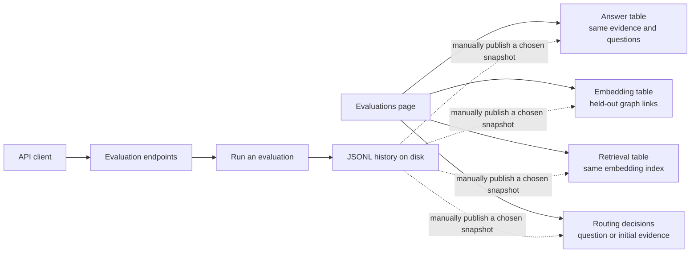
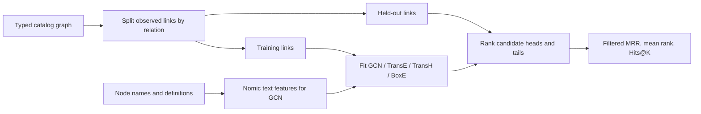
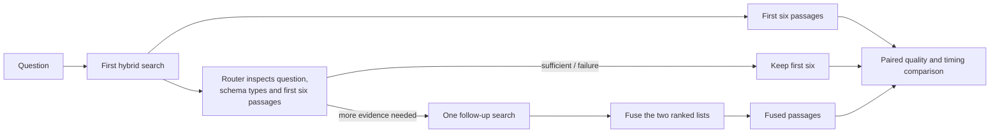

# Evaluations

[Project home](../../README.md) · [RAG pipeline](../rag/README.md) · [Graph explorer](../graph/README.md) · [Architecture](../architecture.md)

CDM RAG evaluates answer generation, graph embeddings, retrieval, and routing decisions. Open [the evaluations page](http://localhost:8124/benchmarks) while the app is running to navigate to their tables.

The four pages present **fixed, read-only snapshots** committed with the application. They do not start runs or automatically update when a new run is saved. Results identify their source and scope. The routing, retrieval, and generation pages link to questions and saved per-case outputs; green and blue mark the best and second distinct observed values per metric, and one star marks a provisional recommendation for each model role. The graph embedding table marks its leader by the named metric. Timings depend on the machine, model residency, and cache state.



## Answer evaluation

The [answer page](http://localhost:8124/benchmark) compares models on the same set of questions, references, and retrieved passages. The evaluation retrieves once for each question, deduplicates sources, and gives each model the same context, with reranking disabled. Models run sequentially; answers are then embedded for similarity scoring and judged by a local model.

The original Mac Studio run compares `qwen3:4b`, `qwen3.5:9b-q4_K_M`, and `gemma4:12b` on six questions, with `qwen3:4b` as judge. The page shows only its two test cases; development and custom questions remain available for inspection. The run reuses four questions from [`cdm-schema-evaluation-v2.json`](../../evaluation/cdm-schema-evaluation-v2.json) and adds two multi-entity questions in [`answer-benchmark-v1.json`](../../evaluation/answer-benchmark-v1.json). The questions are assistant-authored and source-checked, not independently reviewed.

| Metric | Meaning |
| --- | --- |
| Cosine similarity | Similarity between embeddings of the answer and the reference, with citation labels stripped before embedding. It is a semantic proxy, not a factuality check. |
| Cited-entity F1 | Precision and recall of cited entity IDs against expected IDs, combined as F1. |
| LLM judge | Local judge score from 1 to 5, considering the question, reference, answer, and retrieved evidence. |
| Aggregate / 100 | Equal-weight mean of normalized cosine, cited-entity F1, and normalized judge score. Cosine is mapped from −1…1 to 0…1 and judge score from 1…5 to 0…1. Rows missing a required component do not receive a composite. |
| Mean generation and peak model memory | Observed generation time and maximum loaded-model size reported by the runtime; this is not total machine RAM usage. |

The saved run also contains per-question answers, references, citations, retrieval diagnostics, judge rationales, and runtime information. The judge is also a tested model, one 4B response was an extractive fallback, and the judge applied its own rubric inconsistently. The selected context omitted some expected entities in the two multi-entity cases. This small automated sample does not establish a general winner. See the [Mac Studio answer report](../../evaluation/results/macstudio-2026-11-24-answers.md).

A [separate paired experiment](../../evaluation/results/macstudio-2026-11-24-paired-answers.md) compares raw and rewritten retrieval feeding the same answer model and judge. The judge scored rewritten answers higher in three of four development cases and tied both test cases, but manual review found unsupported connections and omissions even in highly scored answers. It does not establish an answer-quality gain.

The page also shows a fixed-evidence review, where the same questions and saved passages were supplied to several answer models. Its star marks Gemma 4 12B as a provisional generation candidate, not a production guarantee: on four test outputs it completed all four, had cited-support issues in two, and was substantially complete in one. Its mean generation time was 8.32 seconds on that host. Some reviews were unblinded and model settings differed; see the [fixed-evidence report](../../evaluation/results/macstudio-2026-11-24-fixed-evidence-blind-review.md) and the page for those limits. The star does not itself change application settings; Gemma 4 12B was subsequently selected in the local Mac Studio configuration.

A separate [27B thinking follow-up](../../evaluation/results/macstudio-qwen35-27b-reasoning-stream-followup.md) captured the stream for one development case after two earlier empty answers. The model repeatedly checked similar reasoning, then produced a supported answer after 308.7 seconds and 4,197 generated tokens. The earlier attempt's 4,096-token limit is a plausible contributor to its empty response, but the later prompt and context settings changed, so the cause is not established. The capture is saved locally under `data/macstudio-runs/` rather than committed; reasoning and answer fragments may contain case inputs and should be treated like other local run logs.

To repeat the capture when the saved local question and evidence are available, use [`scripts/capture_reasoning_stream.py`](../../scripts/capture_reasoning_stream.py). For the recorded case:

```sh
uv run --locked python scripts/capture_reasoning_stream.py \
  --input data/macstudio-runs/answer-qwen35-27b-thinking.json \
  --case-id paired-dev-card-customer --arm rewrite --model qwen3.5:27b-q4_K_M \
  --output data/macstudio-runs/new-reasoning-stream.ndjson
```

The input is an ignored local artifact, not a tracked dataset; the old prompt cannot be reconstructed from it. The helper defaults to a 32,768-token context, a 300-second read-inactivity timeout, and no fixed prediction limit. It refuses to overwrite its output. Capture and any concurrent app inference share host resources; run in isolation.

## Graph embedding evaluation

The [embedding page](http://localhost:8124/embedding-benchmark) evaluates held-out link prediction without questions or generated answers. A typed graph is derived from the CDM catalog, including entity relationships, trait applications, manifests, and inheritance. The graph is split by relation. Development fits on training links; test fits on training plus development links and evaluates held-out test links.



Trainable GCN variants use one, two, or three normalized adjacency layers and a DistMult decoder. Node features come from names and definitions; graph message passing and training negatives use only links available to that fit. TransE, TransH, and BoxE are graph embedding baselines. Evaluation ranks type-compatible candidate heads and tails and filters other known positive links from each ranking. The table reports fit, feature preparation, and ranking separately; cached feature preparation is identified so it is not mistaken for a cold build.

**MRR** is the mean reciprocal rank of the expected link: a correct first result contributes 1, a second result contributes 1/2, and so on. **Hits@K** is the proportion of predictions in the top K; lower mean rank is better. The published test snapshot has 128 held-out links and 256 head/tail predictions. BoxE has the highest filtered MRR in that snapshot, not necessarily the best latency or a universal advantage on other graphs. Fit times and feature preparation should be considered together when estimating the cost of a new index.

See [`app/evaluation/link_prediction_benchmark.py`](../../app/evaluation/link_prediction_benchmark.py) and [`app/evaluation/graph_retrieval_benchmark.py`](../../app/evaluation/graph_retrieval_benchmark.py) for splitting, training, and scoring.

## Retrieval evaluation

### First search versus an adaptive follow-up

The `adaptive_retrieval` API track compares variants on the same questions. Both start with the raw question and the same top-20 hybrid search. The experimental variant gives a local router the question, a short list of CDM object types, and the first six retrieved passages, with up to 2,500 characters per passage. It can request one additional query; reciprocal-rank fusion then combines both top-20 lists. Both lists are scored at six and 20 passages. Router failures and failed follow-up searches fall back to the first results. No answer generation or reranking is performed, and reference labels are never included in the router prompt.



The report includes recall, MRR and whether all labeled evidence was found at six and 20 passages, paired improvements and regressions, follow-up and error counts, and router and search timings. It also scores successful follow-up queries alone against the first search on that same subset. Those conditional scores are not comparable to a full-set baseline. One user-written reference query is evaluated independently on its own case; it is never sent to the router and is not an assumed optimum. The router input and passage rankings are saved for inspection.

The published Mac Studio snapshot compares 4B, 9B and 12B routers on a [separate challenge candidate](../../evaluation/reformulation-challenge-candidate-v1.json), with six development and six test cases. The 9B and 12B routers' follow-ups improved average test labeled recall, but each also worsened one test case at six passages; the 4B router requested no follow-ups. A separate 31B pilot covers only one development case and was stopped for memory pressure; its result is not comparable to a six-case average. The 9B and 12B runs used the same questions, index and inputs, with requested context sizes selected using the same heuristic; actual truncation was not independently measured. The cases are source-derived, published, incompletely labeled and not independently reviewed; splits share sources and families. See the [Mac Studio retrieval report](../../evaluation/results/macstudio-2026-11-24-retrieval.md) for the earlier 4B and 9B per-case results and the [earlier MacBook v2 comparison](../../evaluation/results/adaptive-retrieval-v2/README.md), which used different cases. The previous [v1 comparison](../../evaluation/results/adaptive-retrieval-v1/README.md) used different excerpts and fusion. This experiment does not switch on adaptive retrieval for ordinary questions.

To run it, select case IDs from the options endpoint and send `track: "adaptive_retrieval"`, one supported embedding model, one `query_model`, and the matching `split` to `POST /api/v1/retrieval-benchmark/stream`. For example:

```sh
curl -N http://localhost:8124/api/v1/retrieval-benchmark/stream \
  -H 'Content-Type: application/json' \
  -d '{"track":"adaptive_retrieval","split":"development","models":["nomic-embed-text:latest"],"query_model":"gemma3:4b","question_ids":["adaptive-v2-dev-mortgage-holding","adaptive-v2-dev-group-holdings"]}'
```

The results and decisions are saved in the retrieval evaluation history. Timings include model loading and unloading as observed on the host; they vary with residency and hardware.

### Query formulation on one search

The earlier query-formulation experiment keeps `nomic-embed-text:latest` and the hybrid Chroma/BM25 index fixed while comparing raw contextual input, planner-generated queries, and rewrite-only queries across local query models. It uses no reranker or answer generator. The contextual cases give each strategy the same preceding messages and current question, then score retrieved entities or exact catalog passages.

The original Mac Studio snapshot uses four development and four test follow-ups with provisional source-checked labels from [`contextual-retrieval-v1.json`](../../evaluation/contextual-retrieval-v1.json). Reformulation helped some cases and lost labels in others; none of the original generated test strategies exceeded raw search on average MRR@6. A subsequent retest strengthened both model instructions and query construction by preserving the current question and, for follow-ups, bounded previous user wording. The 9B planner's test MRR@6 rose from 0.375 to 0.813 while its development MRR fell from 1.000 to 0.708; the 9B rewrite's test MRR rose from 0.625 to 0.800 with one test case falling from rank 1 to rank 5. These published cases were used to investigate the failures and do not independently establish generalization; prompt and query construction changed together. The retrieval page presents both original and retest run IDs. The initial index build and query-embedder warm-up were reported separately from per-query timings. This measures how the first query is formulated; it does not measure an evidence-conditioned second search.

Other API tracks support entity and catalog-object passage retrieval, question-based relationship-edge retrieval, and reranker comparisons. The reranker experiment holds query strategy and embedding model fixed and compares a no-rerank baseline with selected rerankers. BCE and BGE require the optional `requirements-reranker-benchmark.txt` dependencies. These additional experiments do not appear as interactive controls on the snapshot pages.

## Routing decisions

The [routing page](http://localhost:8124/routing-benchmark) compares a decision model in isolation across three choices: search as written, rewrite then search, or do not search. It also scores a separate binary scope dataset, accepting either search route when schema search is appropriate. The three-way dataset has nine development and 18 test cases; the derived scope test has 32 cases. The page displays development questions and expected choices alongside test results and per-case model outputs. Development is for tuning, not model training.

Question-only models were compared with an evidence-aware variant that first performs hybrid Nomic/BM25 search and gives the classifier up to three excerpts of 700 characters, without LLM reranking. On this small three-way test, evidence-aware Qwen 3.5 9B scored 14/18; on the binary scope test it scored 32/32, averaging 2.03 seconds for initial search plus classification. The scope experiment searched **every** question before classification, including out-of-scope questions; the reported false-search decisions do not count that initial probe. The local app runs the existing semantic and scope guards before the evidence-aware classifier, so experiment timings are not end-to-end app timings. These published cases were inspected during development and are not an independent blind holdout.

The no-LLM baseline embeds the raw input and compares the nearest indexed fragment's raw cosine similarity to a threshold; it never rewrites. The threshold is selected using only 31 development examples (nine three-way and 22 original scope cases), maximizing balanced search/no-search accuracy and choosing the higher threshold on ties. It scored 15/18 on the three-way test's binary search decision and 27/32 on the binary scope test, with two false searches and three missed searches on the latter, at about 0.05 seconds per warm probe. This uses a nearest vector fragment, not the top hybrid-search result. Thresholds, timing, and accuracy are index-, model-, dataset-, and host-specific.

The decision model and query generator are independent roles: the local Mac Studio configuration uses Qwen 3.5 9B for decisions and Qwen 3 4B when rewriting is requested. It now uses Qwen3 Embedding 0.6B, whereas the saved routing and retrieval comparisons used Nomic; the combined setup has not been evaluated as a combined setup. Repository defaults remain the smaller local planner; see [RAG configuration](../rag/README.md). The standalone experiment scripts ([question-only](../../scripts/benchmark_router_decisions.py), [evidence-aware](../../scripts/benchmark_evidence_router.py), and [cosine gate](../../scripts/benchmark_cosine_router.py)) do not acquire the app's model-work lock and must run in isolation. They save local records; the `export_*_snapshots.py` scripts publish sanitized, validated snapshots explicitly.

## Run or inspect evaluations through the API

Start the application as described in the [project README](../../README.md). Install the models you plan to use in Ollama and consult the [API documentation](http://localhost:8124/docs/api) for request schemas. The options endpoints report the installed eligible models and dataset IDs:

```sh
curl http://localhost:8124/api/v1/benchmark/options
curl http://localhost:8124/api/v1/retrieval-benchmark/options
```

For example, a small query-processing comparison using an installed Nomic embedding model and Qwen query model can be requested as an event stream:

```sh
curl -N http://localhost:8124/api/v1/retrieval-benchmark/stream \
  -H 'Content-Type: application/json' \
  -d '{"track":"query_processing","split":"development","models":["nomic-embed-text:latest"],"question_set":"contextual","question_ids":["context-dev-overdraft-entity"],"query_methods":["raw","rewrite"],"query_models":["qwen3:4b"]}'
```

The server streams progress and finishes with a result or error event. To request held-out link prediction, use `track: "link_prediction"`, a `development` or `test` split, and supported `graph_methods`; GCN also needs exactly one installed embedding model for node features. Answer comparisons use `POST /api/v1/benchmark/stream` with `models`, `question_ids`, and optionally `judge_model`. Long runs share a model lock with normal queries and can take substantial time and memory.

Completed answer runs are appended to `data/benchmark_runs.jsonl`; retrieval and link-prediction runs use `data/retrieval_benchmark_runs.jsonl`. `CDM_RAG_DATA_DIR` changes the data root. Retrieve recent run metadata or a full run by UUID using `GET /api/v1/benchmark/runs[/{run_id}]` and `GET /api/v1/retrieval-benchmark/runs[/{run_id}]`. Results can be returned even when saving fails, so inspect `log_persisted`. Cached indexes and graph features are stored under the data directory rather than committed model weights. These files may contain questions and generated answers.

## Interpreting results

The catalog covers the pinned Microsoft CDM Retail Banking and `applicationCommon` scope, rather than all of CDM. Evaluation labels are incomplete, and most cases are synthetic and not independently reviewed. Held-out graph prediction measures a different task from finding relevant passages, and a high retrieval score does not prove that a generated answer is correct. Use development cases for method choices and reserve the test split for a final comparison. When comparing timings, record hardware, model versions, warm-up, and whether indexes or features were cached.
