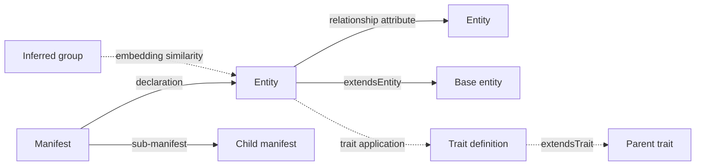
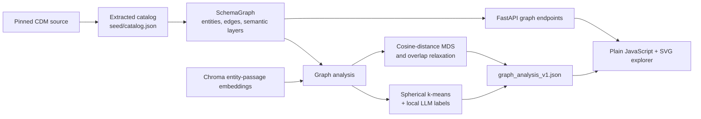

# Graph explorer

The graph explorer shows the loaded Microsoft Common Data Model (CDM) catalog as one navigable canvas. Open [the local explorer](http://localhost:8124/graph) after [starting the app](../../README.md#start-locally). The graph combines entity relationships with manifest, trait, inheritance and inferred-group layers; the side panel explains the selected item. It is a visualization of the extracted schema, not customer data.

## Explore the canvas

- Drag empty space to pan; scroll or use **+** and **−** to zoom; **Fit all** reframes the canvas. The full loaded graph remains present as focus moves: **Infinite hops** does not replace it with a new neighborhood.
- Select **Full screen** in the graph toolbar to expand the graph and legend. Select **Exit full screen** or press **Escape** to return to search and the details panel; the current graph view and selections are retained. If the browser does not allow native full screen, the graph expands to fill the browser instead.
- Search for an entity, attribute, or resolved relationship by keyword. Choose a hit, use the previous/next buttons or the up/down arrow keys to cycle matches. **Escape** abandons the jump and restores the starting location; if an attribute detail card is open, Escape closes that card first.
- Click a node, edge, trait, manifest, base type, or group for its details. Entity relationships have direction arrows; the legend identifies the colors used for each source model.
- Use the legend to show or hide entities, relationships, manifests, inheritance, and inferred groups. **Traits** opens individual trait controls; **Group filters** selects which inferred categories are shown. These controls can be combined.
- Turn on **Node details** to show a scrollable attribute list within each entity card and relationship labels on the graph. Select an attribute or use its ↗ control to undock a detail card. Drag the lower-right handle to resize a node; double-click the handle to restore its default size.

Search, selection, filters, node sizes and the viewport live in the current page only. The explorer does not record search terms, visited nodes, or session history.

## What is represented

Entity relationships are directed references resolved within the loaded catalog. The overlay also represents manifest nesting and declarations, applied traits and trait inheritance, and declared entity inheritance. Details include source paths and retained metadata; manifest references outside the loaded entity subset remain metadata or placeholders rather than loaded entity definitions. Inferred groups and their model-generated labels describe clusters of embeddings; they are not Microsoft CDM categories or evidence of a relationship.

The bundled catalog covers the Retail Banking and common schema subset. Parsing does not implement full CDM SDK resolution of imports, inheritance, traits, or polymorphic references. Unresolved references are retained as metadata, so an absent edge does not establish that a relationship is absent from the full CDM. See [catalog scope](../../README.md) and the source files under [`seed/`](../../seed/).

## How the visualization works

[`app/graph.py`](../../app/graph.py) constructs an in-memory projection with stable entity IDs, resolved relationship edges and CDM semantic layers. [`app/main.py`](../../app/main.py) serves the graph and search endpoints. [`web/graph.html`](../../web/graph.html) draws and manages the canvas in SVG with plain JavaScript and CSS; it does not require a graph visualization framework or Vite.

[`app/graph_analysis.py`](../../app/graph_analysis.py) retrieves each entity passage's existing embedding from Chroma, computes a two-dimensional **classical multidimensional scaling (MDS)** layout from cosine distances, and relaxes overlapping node rectangles. It also groups normalized embeddings using deterministic spherical k-means and asks the configured local answer model to label each group from representative entity names and descriptions. Labels are inferred and can be imperfect. The layout is based on semantic similarity, so proximity alone does not prove an edge or meaningfully reproduce every relationship; overlap relaxation can also move nodes away from their initial positions.

The browser first renders a fallback layout, then applies the embedding layout and groups when analysis is ready. If analysis fails it retains the fallback layout. If label generation fails, representative entity names supply temporary group labels. Successful labels and coordinates are cached in `data/graph_analysis_v1.json` (or `CDM_RAG_DATA_DIR`) against graph revision, index revision, algorithm version and label model. A failed labeling attempt is not reused as a successful cache; a later request can retry it. The initial analysis can require a local model call, while refreshing a valid cache avoids repeating it.

## Developer entry points

These endpoints support the explorer and are excluded from the generated API schema:

| Endpoint | Purpose |
| --- | --- |
| `GET /api/v1/graph/overview` | Counts, source revision and initial entity. |
| `GET /api/v1/graph/all` | The full loaded graph, entity details and semantic layers. |
| `GET /api/v1/graph/search?q=…` | Ranked keyword hits for entities, attributes and resolved relationships. |
| `POST /api/v1/graph/analysis` | Cached or computed positions and inferred groups. |
| `GET /api/v1/graph/neighborhood` | Bounded neighborhood data for a specified entity; the explorer uses the full graph canvas. |

For the relationship between graph data and answer retrieval, see the [architecture guide](../architecture.md). Graph-embedding quality is evaluated separately from visualization layout; see [benchmarking](../benchmarking/README.md).
