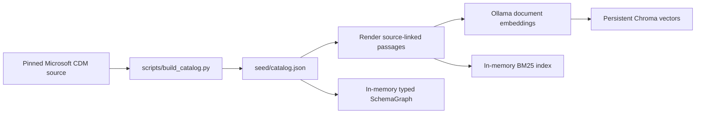
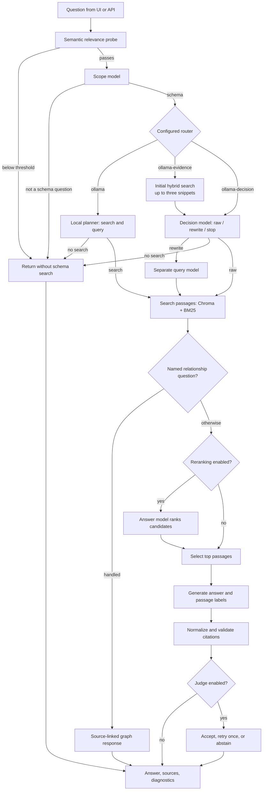

# RAG: from a question to a cited answer

CDM RAG answers questions about the Microsoft Common Data Model (CDM) definitions in a pinned, extracted catalog. It searches source-linked passages about entities, attributes, relationships, manifests, traits, and inheritance, then supplies a small selection to a local language model. The catalog covers the retail banking and application-common regions; it contains schema definitions, not live customer records or the full CDM standard.

See the [project README](../../README.md) to start the app, the [architecture guide](../architecture.md) for the full system, and the [benchmark guide](../benchmarking/README.md) for the evaluations. The interactive API reference is at `/docs/api` while the app is running.

## Data preparation



The catalog builder records source URIs and extracted definitions. [`app/corpus.py`](../../app/corpus.py) turns this material into passages; long material can be split so that embedding inputs fit the model. [`app/index.py`](../../app/index.py) keeps lexical and vector search over those passages and constructs the graph projection. It reuses a matching Chroma collection when its passage and model identity still match; otherwise it builds the collection. The collection identity incorporates the rendered chunks and the embedding model, digest, and format. BM25 and the graph are reconstructed in memory at startup.

Ollama applies the appropriate query/document formatting for the supported embedding families and requests embeddings with truncation disabled. The default `qwen3-embedding:0.6b` embedder can be changed with `EMBEDDING_MODEL`; the index identity changes with it. Query embeddings default to `keep_alive=0`, which unloads the embedder after use to free memory for generation.

## Answer path



1. A semantic probe checks the original question against the nearest indexed passage. The model-specific threshold is a heuristic, not proof of relevance. A separate scope model distinguishes questions about CDM definitions from requests for records, deployed behavior, or other out-of-scope material.
2. The repository-default `ollama` planner decides whether to search and supplies a short search query. The optional Jev router is hosted and sends the question to TypeSafe; it requires explicit configuration and can fall back to the local planner.
   The optional `ollama-decision` and `ollama-evidence` backends separate the decision model (`CDM_RAG_DECISION_MODEL`) from the query generator (`ROUTER_MODEL`). The evidence variant runs a local hybrid search first and gives the classifier up to three excerpts of 700 characters, without LLM reranking. The existing semantic and scope guards still run beforehand; a failed evidence pre-search or decision stops the route. The current question API does not supply conversation history to this live route; context-dependent routing scores in the benchmark do not establish end-to-end follow-up support.
   When the planner or rewrite path is selected, the search input also preserves the original question. For a follow-up with a reference such as “it” or “that”, it adds up to 1,200 characters of the most recent prior user turn; it does not add prior assistant text. This is a retrieval aid, not evidence that either the rewrite or the prior turn is factually correct. Older benchmark snapshots used the earlier query without this anchor.
3. Hybrid retrieval combines Chroma semantic ranks and BM25 lexical ranks by reciprocal-rank fusion. `semantic` and `lexical` modes are also available. A relationship question with identifiable entities can be answered from explicit directed graph edges and, in some cases, a bounded two-hop path. The absence of an extracted direct edge is not proof that the relationship is absent from the full standard.
4. Optional reranking uses the configured answer model to rank candidates; it defaults to off. The answer model sees the highest-ranked passages, not expanded entities. `CDM_RAG_GENERATION_PASSAGE_LIMIT` defaults to 4 and accepts 1–4. The API `limit` controls the number of retrieved passages considered before that generation cap.
5. The answer model is instructed to use supplied evidence and draft short labels such as `[R1]`. The app repairs a few unambiguous formatting errors, checks labels against the supplied sources, and converts them to readable entity or catalog citations. When labels are invalid or absent, it returns source excerpts instead. A valid citation label does not establish that every claim is supported.
6. Optional answer review can accept, abstain, or request one answer or retrieval retry. A retry needs a successful second review. Judge review defaults to off; graph responses and requests stopped earlier skip it. If the first judge call fails, the citation-validated initial answer remains available.

With the repository-default planner, the decision precedes retrieval. The `ollama-evidence` option instead performs an initial search before deciding. This is distinct from the [retrieval benchmark](../benchmarking/README.md)'s adaptive follow-up experiment, which asks for an additional query and fuses its ranking with the first search; adaptive fusion is not part of the normal question path.

The graph is an in-memory projection of extracted references, not a graph database. See [graph documentation](../graph/README.md) for its semantic layers and visualization.

## API and streaming

With the app running locally, a synchronous request is:

```sh
curl -X POST http://localhost:8124/api/v1/query \
  -H 'Content-Type: application/json' \
  -d '{"question":"What are the core attributes of the Account entity?","mode":"hybrid","rerank":false}'
```

The request requires `question` (1–2,000 characters); `mode` defaults to `hybrid`, `rerank` to the configured default, and `limit` to 6 (range 1–12). The response includes the answer, cited sources, passages used as context, and retrieval diagnostics. A query UUID is returned as `query_id` and in the `X-Query-ID` response header. `/api/v1/status` reports current model configuration.

For live output, send the same JSON to `/api/v1/query/stream`. It returns server-sent events containing stage changes, generated text, and a final `result` or `error`; keep-alive comments can appear between events. Streamed text is provisional: citation normalization, fallback, or optional judge review can change the final answer, so use the final result as the authoritative response. Requests do not retain conversation history. Query and benchmark inference share a lock to avoid concurrent model workloads on constrained machines.

Each query is recorded in `data/query_logs.jsonl` (or the configured `CDM_RAG_DATA_DIR`) with its ID, timings, model details, outcome, and question/answer. This is a local disk log containing user input. Model settings can be read or changed via `/api/v1/settings/models`; updates affect subsequent requests across the app and persist in `model_settings.json`. Embedding model selection remains an environment setting because it determines the index.

## Models and configuration

| Role | Default | Configuration |
| --- | --- | --- |
| Embedding | `qwen3-embedding:0.6b` | `EMBEDDING_MODEL` |
| Planner / query generator | `qwen3:4b` | `ROUTER_MODEL` |
| Separate decision model | `qwen3:4b` | `CDM_RAG_DECISION_MODEL` for `ollama-decision` or `ollama-evidence` |
| Scope check | `qwen3:4b` | `SCOPE_MODEL` |
| Answer and optional reranking | `qwen3:4b` | `ANSWER_MODEL`, `CDM_RAG_RERANK_ENABLED` |
| Optional answer judge | `qwen3:4b`, disabled | `JUDGE_MODEL`, `CDM_RAG_JUDGE_ENABLED` |

These are repository environment defaults; persisted model settings can override the non-embedding roles. The Mac Studio's local configuration selects `qwen3-embedding:0.6b`, `CDM_RAG_ROUTER_BACKEND=ollama-evidence`, `CDM_RAG_DECISION_MODEL=qwen3.5:9b-q4_K_M`, `ROUTER_MODEL=qwen3:4b` for query generation, and `gemma4:12b` for answers. Before a main-query answer model is invoked, the app unloads other resident Ollama models and checks that they have exited; an unloading failure stops generation. The application's lock coordinates its own work, not other clients of the Ollama server, whose models may also be unloaded. The model selection is provisional: the routing benchmark used Nomic embeddings, not this Qwen index. `OLLAMA_BASE_URL` selects the Ollama host. The configured host and Ollama choose the actual hardware runner; models and GPU support must be installed there. Chat prefill has a default 300-second first-token timeout followed by a 30-second idle timeout; reasoning tokens count as activity, so an active stream can run longer. See [`.env.example`](../../.env.example) and [`app/ollama.py`](../../app/ollama.py) for current settings.

## Scope and limitations

- Retrieval covers the facts represented by the extracted catalog, including non-entity CDM concepts. The catalog parser and loaded source region do not cover every CDM artifact.
- The semantic gate, scope classifier, query planner, answer model, and optional judge can make mistakes. Citations help locate evidence but do not independently verify claims.
- Hybrid search and passage selection can miss necessary evidence; the small generation cap trades context coverage for resource use. The graph only establishes relationships from explicit extracted references.
- The local app is a demo without authentication. Use a suitable access boundary before exposing it online; its logs contain submitted questions and answers.
