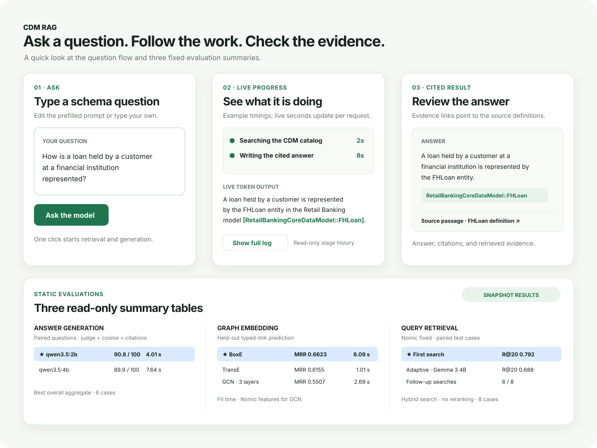

# CDM RAG extended reference

This page preserves detailed setup notes, implementation explanations, and evaluation history. Start at the [main README](../README.md) and see the focused guides for [RAG](rag/README.md), [graph visualization](graph/README.md), and [evaluation guide](benchmarking/README.md).



A question moves from the prefilled prompt through live stage timings and token
streaming to a cited answer. The Evaluations page has read-only summary
tables: answer generation, held-out graph link prediction, retrieval under
different query-generation strategies, and routing decisions. The embedding evaluation fits
GCN, TransE, TransH, and BoxE on training links without using questions. The
retrieval summary fixes Nomic Embed Text and compares a first search with an
experimental evidence-informed follow-up. The timings shown are illustrative; actual
duration varies by query and model. [Start the app](#start-the-demo) · [Read the evaluation details](#evaluations) ·
[Explore the architecture](../docs/architecture.md)

A small FastAPI demonstration that answers questions about Microsoft's Common
Data Model (CDM), with a focus on the Retail Banking model and common objects.
Each request is independent; there are no user accounts, sessions, or stored
conversations. It runs locally with Ollama and a persistent Chroma vector
database.

## Start the demo

Install [uv](https://docs.astral.sh/uv/) and
[Ollama](https://ollama.com/), start Ollama, and download the configured models
once. With the example settings:

```sh
ollama pull qwen3-embedding:0.6b
ollama pull qwen3:4b
cp .env.example .env   # only on first setup; keep local model choices in .env
uv sync
./scripts/run_local.sh
```

The first start builds the vector index from the included catalog passages,
including manifests, traits, and other extracted semantics. This can take a
little while. Subsequent starts reuse the persisted index. The native
launcher binds only to `127.0.0.1`. Docker Compose remains available as an
optional launch method.

- Open the project home at <http://localhost:8124/home>.
- Open the one-question RAG interface at <http://localhost:8124/RAG>.
- Open the graph explorer at <http://localhost:8124/graph> to search keywords and navigate linked CDM entities.
- Open the evaluations page at <http://localhost:8124/benchmarks> to choose among the answer, embedding, retrieval, and routing evaluations.
- Open the documentation home at <http://localhost:8124/docs>, with the design overview and interactive API reference.
- Open the interactive API reference directly at <http://localhost:8124/docs/api>.
- Check the indexed scope and model names at <http://localhost:8124/api/v1/status>.
- Choose API-wide local model roles in Settings, or use `GET` and `PUT`
  `/api/v1/settings/models` from another client.

The port binds to `127.0.0.1` and the demo has **no authentication**. It is
intended for a laptop demonstration, not an internet-facing deployment.

The graph explorer searches entity names, attributes, and resolved
relationships. Select a hit to jump to its location in the full graph, then
click any node to keep navigating. Use the arrow keys or previous/next
controls to cycle through hits; Escape cancels the jump and returns to the
starting graph location. It keeps the current search and focus in page memory
only: it does not save search terms, visited locations, or session history.
The full loaded catalog stays on one canvas as you move between entities. Pan
the map, zoom in or out, or use **Fit all** to reframe it; the view contains 64
entities and 387 documented links for the current catalog snapshot. Its
positions use classical multidimensional scaling over the index's existing
entity embeddings, followed by overlap relaxation. The same vectors are grouped
by cosine similarity; the currently selected local answer model assigns
readable labels to those groups. Colored category regions and legend filters
let you show or mask each group. The computed layout and labels
are cached on disk in `data/graph_analysis_v1.json`, so refreshing the page does
not rerun the model. If category labeling fails, the graph still opens with
representative entity names as temporary group labels.

Turn on **Node details** to put entity names and categories beside a scrollable
attribute list inside each node. Relationship attribute names appear on the
links in this mode. Node coordinates stay in the embedding layout; drag the
bottom-right handle to resize an individual node, or double-click it to reset
that node to its default size. Use the ↗ control beside an attribute to undock
its type, display name, description, and source path into a floating card.

## Use the API

For the authenticated GPU service, see the [GPU API guide](gpu-api.md) for
token checks, easy and multi-hop terminal examples, streaming progress, and
the complete response with processing metadata. The example below is for the
local profile, which disables API authentication by default.

```sh
curl -X POST http://localhost:8124/api/v1/query \
  -H 'Content-Type: application/json' \
  -d '{"question":"What are the core attributes of the Account entity?"}'
```

The response contains the answer, source links, the passages sent to generation,
and retrieval diagnostics. Inline citations use qualified entity identifiers,
for example `[applicationCommon::Account]`, or readable manifest and trait
labels. The matching `sources` entry has the same `display_citation`, a
`source_label`, and a pinned Microsoft source `uri`; entity passages also carry
their `entity_id`. The `citation` field is the short internal label used during generation.
In the demo, selecting an inline citation opens its definition card and the
card links to the original source. Try also `How does a Contact relate to an
Organization?` or an unrelated message such as `My dog Luna loves tennis
balls.` No schema results are returned when the gate decides not to search.
`mode` can be `hybrid`, `semantic`, or `lexical`. The `rerank` default follows
`CDM_RAG_RERANK_ENABLED`: it is off in the local profile and on in the
independent GPU Compose profile. Demo access retains its restricted search
settings; it can use reranking when the server default enables it. These
switches are useful for evaluation. The endpoint does not preserve
history, so a follow-up containing only “it” has no earlier context.

Each request gets a UUID and is appended to `data/query_logs.jsonl` (or the
configured `CDM_RAG_DATA_DIR`). The log records stage timings, errors, model
names, retrieval diagnostics, and the final answer. The app does not run a
separate tracking service or database.

The Settings dialog can change the local answer, routing-decision, query-generation, scope-check, and
judge models for the entire API process. Changes take effect for the next query
from any client, and the old model is unloaded when no remaining role uses it.
Choices are saved to `data/model_settings.json` (or the configured
`CDM_RAG_DATA_DIR`) and survive app restarts. The embedding model remains
configured through `EMBEDDING_MODEL` because it is part of the index identity;
changing it requires a separate index rebuild.

For example, inspect the installed model choices and current roles, then update
the local app's answer model:

```sh
curl http://localhost:8124/api/v1/settings/models
curl -X PUT http://localhost:8124/api/v1/settings/models \
  -H 'Content-Type: application/json' \
  -d '{"answer_model":"qwen3.5:4b"}'
```

The request validates that the selected name is an installed local chat model
within `CDM_RAG_BENCHMARK_MODEL_MAX_GB` (5 GiB by default). The OpenAPI
documentation describes the settings request and response.

## Evaluations

Open the local app's **Evaluations** page at `/benchmarks` to choose among four read-only result pages. **Answer evaluation** presents comparisons of locally run answer models. **Embedding evaluation** presents held-out link prediction over typed CDM relationships, traits, manifests, and inheritance, with filtered MRR, Hits@K, fit time, and GCN feature preparation time. It uses no question set. **Retrieval evaluation** fixes Nomic Embed Text and compares query formulations and an optional evidence-informed follow-up. It scores entity and exact catalog-passage labels without reranking or answer generation. **Routing evaluation** compares raw-search, rewrite, and no-search decisions, including a cosine-only baseline and preliminary search context. Evaluation APIs continue to save detailed runs in `data/benchmark_runs.jsonl` and `data/retrieval_benchmark_runs.jsonl`.

The evaluation pages are read-only snapshots; each identifies its source and data split. The embedding snapshot reports held-out test links; the retrieval snapshot compares query strategies and paired first-search and adaptive results with Nomic fixed. Routing, retrieval, and generation pages also expose development questions and saved outputs. Labels are provisional and do not establish universal winners.

The answer snapshot reuses four questions from
`evaluation/cdm-schema-evaluation-v2.json` and adds two three-entity cases. It
retrieves once per question and gives each tested model the same passages,
with reranking disabled. Results include answer
cosine similarity, cited-entity precision/recall/F1, candidate and context
entity recall, fallback counts, and generation time. A separately selected
local judge scores answer relevance, completeness, grounding, and citations
against the compact reference and the same retrieved evidence. Per-model
aggregates include mean judge score and an equally weighted 0–100 score built
from normalized cosine, cited-entity F1, and judge score; answers missing any
component are excluded from that aggregate and counted. When the app runs with
local Ollama on Apple Silicon, the evaluation runner preselects supported
installed models.
Each answer and judge result records Ollama's actual runner, loaded model size,
GPU memory allocation, and context length where `/api/ps` reports them. The
answer models are unloaded before similarity scoring and before the judge runs.
Fresh API evaluation runs append full results to `data/benchmark_runs.jsonl`;
the static page shows the identified snapshot only. The benchmark API limits
eligible models to `CDM_RAG_BENCHMARK_MODEL_MAX_GB` (5 GB by default).

Older saved passage-retrieval runs remain available in the JSONL history. The
published retrieval table keeps Nomic Embed Text fixed and compares first-pass
and adaptive retrieval; embedding quality is measured separately with held-out
graph link prediction. Persistent Chroma passage indexes remain under
`data/retrieval_benchmark_indices/`.

The retrieval evaluation API still supports detailed experiments beyond
the static summary table. Its **Query processing** track compares raw wording,
the local planner (whether to search and its chosen query), and rewrite-only
queries. API clients can choose an entity-question or catalog-object set and
up to six installed local chat models. Every variant searches the same hybrid
index with one fixed text embedder and reranking disabled. The contextual
follow-up set in `evaluation/contextual-retrieval-v1.json` supplies identical
prior messages and current questions to each strategy, scoring entity IDs or
exact catalog-object passages. The **Reranking** API track fixes one query
strategy and inference model, builds the same top-20 hybrid candidate set once
per question, then compares its no-rerank baseline with selected rerankers. Available choices are the configured
Ollama answer-model reranker, [BCE](https://huggingface.co/maidalun1020/bce-reranker-base_v1), and
[BGE](https://huggingface.co/BAAI/bge-reranker-v2-m3). Query and reranker models are run sequentially
with the embedder unloaded between stages; cross-encoder models are loaded one
at a time. Query inference, search, reranking, end-to-end latency, and
cross-encoder load time are reported separately. BCE and BGE are optional and
their weights download from Hugging Face on first use. To enable those choices,
install the optional evaluation extra with `uv pip install -r requirements-reranker-benchmark.txt`; restart the local app afterward. This installs PyTorch and sentence-transformers but does not change the normal API dependencies. The
cross-encoders use PyTorch CUDA when available, Apple MPS on supported Macs, or
CPU otherwise. The chosen embedding model stays constant within each of these
experiments, avoiding a model-by-query-by-reranker Cartesian product.

`OLLAMA_BASE_URL`, `EMBEDDING_MODEL`, `ROUTER_MODEL`, `CDM_RAG_DECISION_MODEL`, `ANSWER_MODEL`, `SCOPE_MODEL`,
`JUDGE_MODEL`, `CDM_RAG_JUDGE_ENABLED`, `CDM_RAG_MIN_SIMILARITY`,
`CDM_RAG_GENERATION_PASSAGE_LIMIT`, and `CDM_RAG_RERANK_ENABLED` can be set in
`.env` or the Compose environment. The provisional
default is Qwen3 Embedding 0.6B with a 0.58 preflight threshold. Nomic remains
available as `EMBEDDING_MODEL=nomic-embed-text` with its own 0.60 default;
install it with `ollama pull nomic-embed-text`. The implementation applies each
model's query and document conventions and rejects unsupported model families.
Changing model or input format creates a separate index; model files and indexes
are not committed to Git. Thresholds are preliminary and model-specific.

Inference hardware follows the configured Ollama server. On Apple Silicon,
Ollama can use Metal or MLX for supported models and runners. On this Mac Studio,
the Gemma 4 12B runner was observed as MLX. For an NVIDIA GPU
server, set `OLLAMA_BASE_URL` to that server's Ollama API address; Ollama uses
CUDA when the server has CUDA support. The app and benchmark use the same
Ollama API, and evaluation results store the runner Ollama reports rather than
assuming it from a model tag.

The local embedder is loaded only for embedding requests and receives
`keep_alive=0`, so Ollama unloads it after each query embedding. This leaves
more memory available for the answer model at the cost of a short cold load on
the next embedding request. `docker compose down` stops the optional container;
its named index volume is retained.

The default `CDM_RAG_ROUTER_BACKEND=ollama` keeps routing local: Qwen decides
whether to search and produces a short retrieval query. `ollama-decision` uses
`CDM_RAG_DECISION_MODEL` for a separate local route decision and `ROUTER_MODEL`
for a rewrite when requested. `ollama-evidence` adds a preliminary hybrid
search, passes up to three bounded excerpts to that decision model without LLM
reranking, and retains the semantic and scope guards before the search. The
current live API does not supply prior conversational turns to this router.
The local Mac Studio configuration selects evidence-aware Qwen 3.5 9B with
Qwen 3 4B for rewriting; repository defaults are unchanged. Its measured
trade-offs and limitations are in the [evaluation guide](benchmarking/README.md).
Set
`CDM_RAG_ROUTER_BACKEND=jev` to try TypeSafe's typed [Jev API](https://api.typesafe.ai/redoc).
Set `JEV_API_KEY` and optionally `JEV_MODEL` (default `jev-latest`),
`JEV_BASE_URL`, and `CDM_RAG_ROUTER_MIN_CONFIDENCE` (default `0.70`). Jev
classifies a request as `raw_search`, `rewrite_search`, or `no_search`. A raw
search sends the original wording to Chroma and BM25. A rewrite uses the local
Qwen router model only to produce a search query. Low-confidence decisions fall
back to the existing local planner, as do service errors and invalid responses.
The hosted router has not yet been evaluated against the local planner. Jev receives the user's question text, so
enabling it sends each routed question to TypeSafe. The default remains fully
local. Neither route currently issues SQL or SPARQL: the graph is an in-memory
projection, not a queryable graph database.

## How it works

Before the local query planner runs, a scope check asks whether the request is
about CDM definitions or needs actual records, current bank data, or deployed
software behavior. It searches only for schema questions. Requests for records,
runtime behavior, mixed questions, unclear intent, or a failed scope check are
returned without retrieved sources. This is a model-based guard, so the
questions and scorecard in the [scope and judge pilot](../evaluation/scope-guard-v1.md)
document its tested limits. `SCOPE_MODEL` selects the scope model and defaults
to `qwen3:4b`.

1. A preliminary semantic search estimates whether a question is near the
   indexed schema. With the default local planner, Qwen decides whether to
   search and creates a natural-language search query. The optional local
   evidence-aware decision route first examines hybrid search results and can
   use a separate query model for rewriting. With Jev enabled, Jev
   chooses between using the original wording, asking local Qwen to rewrite it,
   and skipping search. Low-confidence Jev choices fall back to the local
   planner. The threshold is configurable and experimental.
2. Compact passages cover every fact extracted into the catalog: entities and
   attribute groups, explicit and unresolved relationship references, trait
   definitions and applications, entity inheritance, manifest summaries and
   declarations, manifest nesting, and manifest relationship mappings. Large
   mapping lists are divided into small source-linked passages. They are
   embedded with `qwen3-embedding:0.6b` and stored in Chroma. Embedding requests
   set `truncate: false`, so oversized passages fail instead of silently losing
   text. Hybrid mode combines vector and BM25 ranks.
3. Optional reranking scores the retrieved passages with the configured answer
   model. It is off by default to reserve local memory and compute for answer
   generation. The generator receives only the top passages, capped by
   `CDM_RAG_GENERATION_PASSAGE_LIMIT` (default 4; set to 1 on a tight-memory
   machine). It does not receive full entity expansions.
4. The local model answers from those passages and cites their source labels.
   Relationship questions with named entities can use the directed graph and
   cite each edge's source entity; this avoids asking the language model to
   infer edge direction. If no direct edge exists between the named entities,
   a graph check reports the absence
   of an extracted direct edge and, when available, an explicitly cited
   two-hop path. Other questions, including attribute, manifest, and trait
   questions, use the same retrieved-passage answer path; there is no keyword-specific attribute
   generator. The application validates citation labels and renders them as
   entity, manifest, or trait citations; an invalid or missing label falls
   back to source excerpts. Entities sharing a source file retain separate
   citations. A valid citation does not by itself prove the cited source
   supports every claim, so answers should still be evaluated.
5. When enabled, the configured judge reviews the answer against its cited CDM
   evidence and relevant retrieved edges. It can accept the answer, ask the
   answer model to revise from the same evidence, request one focused retrieval and then a revision,
   or abstain. A second review must accept the revision; otherwise the API
   returns a citation-free abstention. The loop allows at most one retry.
   Judge errors leave the already validated initial answer available. Verified
   graph answers and requests stopped by the scope checks skip the LLM judge.
   Review is opt-in with `CDM_RAG_JUDGE_ENABLED=true`. The default is off:
   an earlier pilot found no measured quality gain, while the same `qwen3:4b`
   model added about five seconds and was not an independent reviewer. A later
   [GPU claim-review pilot](../evaluation/results/gpu-claim-review-2026-11-25.md)
   found that 9B and 14B accepted all five known-problem drafts, while 20B
   with low reasoning caught three. The small diagnostic does not justify
   enabling a reviewer as a reliable safeguard. The `/api/v1/status` response
   reports the configured judge model and whether review is enabled.

The graph is an in-memory projection of explicit references, not Neo4j, RDF,
or a SPARQL endpoint. Similarity alone never establishes a relationship.

## Embedding and retrieval evaluations

The static [`web/embedding-benchmark.html`](../web/embedding-benchmark.html)
page (served at `/embedding-benchmark`) presents the saved graph-embedding
snapshot. The evaluation ranks candidate heads and tails for held-out observed
links, using filtered MRR, mean rank, Hits@1/3/10, fit time, ranking time, and
GCN text-feature preparation time. It uses no questions or question-answer
labels. The graph contains explicit
entity relationships, manifest structure and resolved mappings, trait
applications, and inheritance. Candidate nodes are restricted to their
compatible node type and, for entities, their CDM model. Other known positive
links are filtered from the ranking metric. Results are split by relation on
the pinned graph revision: development fits on training links; test fits on
training plus development links. GCN message passing and the graph-model
optimizer see training links only. GCN node text features contain names and
definitions but not the links being predicted. The source-checked graph
snapshot and assistant-authored evaluation choices remain provisional and do
not claim coverage of the full Microsoft CDM catalog.

The static [`web/retrieval-benchmark.html`](../web/retrieval-benchmark.html)
page (served at `/retrieval-benchmark`) presents paired first-search and
evidence-informed follow-up results using Nomic Embed Text, with entity and
exact catalog-object labels. Cases are source-checked but synthetic and not
independently reviewed. The retrieval evaluation API also supports other
query sets, relationship retrieval, and reranking experiments; those options
do not appear as controls on the published page.

The GCN starts from text-derived node features and trains graph convolution
weights and relation embeddings against training edges. For the held-out link
prediction evaluation, its adjacency and negative sampler see training edges
only. If no type-compatible unobserved corruption exists, that edge/epoch
sample is skipped and counted. It applies the
symmetrically normalized adjacency matrix with self loops, uses ReLU between
layers, and fits a DistMult decoder with binary cross-entropy and up to one
filtered negative per training edge. TransE, TransH, and BoxE fit graph embeddings
with a fixed seed and one corrupted edge per positive edge. Every trainable
method uses 32 latent dimensions and 80 epochs. Fit time includes parameter
initialization, training, and scoring catalog edges; GCN fitting is repeated for
each selected text embedding model, while TransE, TransH, and BoxE fit once per
run. These are structural ranking signals fused with the selected model's BM25
and semantic rankings. Detailed API runs report fit time separately from
text-index preparation, query warm-up, and per-query retrieval latency.

The held-out embedding evaluation and question-based relationship retrieval are
distinct: the latter trains its selected model on the full observed graph to
rank known edges for labeled questions. Its 12 development and 24 test
questions and 16 paraphrase-challenge questions are synthetic, source-checked,
and not independently reviewed. Scores include edge recall at 20, whether all
example edges appear at 20, first-edge MRR at 20, and latency. Query-creation
and reranking experiments also include development/test cases for exact
catalog passages such as attributes, traits, manifests, inheritance, and
relationships. Contextual query cases also test reference resolution from
prior messages. Text feature vectors and indexes are cached on disk by catalog
and model digest; result runs continue to append to
`retrieval_benchmark_runs.jsonl`.

The trainable GCN uses the normalized-adjacency convolution from
[Kipf and Welling](https://arxiv.org/abs/1609.02907) and trains its graph
encoder against observed edges with a DistMult edge-scoring objective. This is
related to unsupervised link-prediction work such as
[Variational Graph Auto-Encoders](https://arxiv.org/abs/1611.07308), but it is
not a variational graph autoencoder.
The graph embedding baselines follow [TransH](https://ojs.aaai.org/index.php/AAAI/article/view/8870)
and [BoxE](https://arxiv.org/abs/2007.06267); TransE is the translational
baseline described in the [original NeurIPS paper](https://papers.nips.cc/paper_files/paper/2013/hash/1cecc7a77928ca8133fa24680a88d2f9-Abstract.html).
The [graph retrieval evaluation report](../evaluation/graph-retrieval-benchmark-v1.md)
is an archived pilot of the earlier fixed-propagation GCN. Its GCN timings do
not include model fitting and should not be compared with the current trainable
methods. Current runs store fitted-method timings with the saved benchmark
results under `data/retrieval_benchmark_runs.jsonl`. The [current graph retrieval
report](../evaluation/graph-retrieval-benchmark-v2.md) records a recent two-embedder
run, including GCN and knowledge-graph embedding fit times.

The later [web-question and lightweight-routing pilot](../evaluation/web-benchmark-v1.md)
compares the same retrieval approaches on public-source question candidates,
includes requests the schema cannot answer, and records a failed LLM-judge
audit. It also documents why the experimental 0.6B router is not the default.

The [relationship pilot](../evaluation/relationships-v1.md) compares the current
hybrid retrieval and reranking baseline with neighborhood-enriched passages,
ranked graph traversal, and traversal with a TransE structural prior. The latter
three are evaluation prototypes; they do not change the serving index or API.
The synthetic questions and example edge labels are not independently reviewed.
The separate [web-question shortlist](../evaluation/web-question-candidates-v1.json)
links public questions and documents possible schema adaptations; it is not yet
an independently reviewed or scored evaluation.

The [judge feedback and bounded retry pilot](../evaluation/judge-feedback-v1.md)
records the live API checks, latency observations, and a judge miss on edge
direction that motivated deterministic answers for qualified relationship
questions. Its saved JSON results can be inspected alongside the pilot notes.

Install the optional offline graph-evaluation dependency in addition to the
normal project environment: `uv pip install -r requirements-graph-benchmark.txt`.
Start the configured local
Ollama models, then run the following from the repository root. Use a separate
evaluation data directory; the scripts create and manage indexes within it.

```sh
uv run python scripts/build_relationship_questions.py
uv run python scripts/build_relationship_challenge.py
uv run python scripts/benchmark_relationships.py --data-dir data/relationship-benchmark \
  --split development --output evaluation/results/relationships-v1/development.json
uv run python scripts/benchmark_relationships.py --data-dir data/relationship-benchmark \
  --split test --output evaluation/results/relationships-v1/test.json
uv run python scripts/benchmark_relationships.py --data-dir data/relationship-benchmark \
  --dataset evaluation/relationship-challenge-v1.json --split test \
  --output evaluation/results/relationships-v1/challenge.json
uv run python scripts/judge_relationships.py evaluation/results/relationships-v1/test.json \
  --output evaluation/results/relationships-v1/test-judge.json \
  --checkpoint data/relationship-benchmark/test-judge-checkpoint.json
```

The judge uses a fixed sample of cases and blinded, pooled evidence; pass the
challenge result to the same command with a different output and checkpoint to
judge that set. Results include per-question evidence IDs and model digests;
rerunning with a fresh index requires downloading model weights.

## Data and provenance

The bundled snapshot was parsed from [Microsoft/CDM](https://github.com/microsoft/CDM)
commit `dd21d715e05ebf740a11356c80b5c3b4c38a89c2`. It includes all 21
manifest-listed Retail Banking entities and all 43 manifest-listed
`applicationCommon` entities: 64 model-qualified entities in total. Definitions
and captured source inputs are in `seed/`; the upstream Microsoft license is
included at `seed/source/LICENSE`. The snapshot contains schema definitions,
not bank customer records.

The parser extracts a useful subset of attributes and entity references. The
search index covers all facts represented in this extracted catalog, including
its semantic metadata; it does not cover artifacts the parser never loaded.
This is not a complete CDM SDK resolution. The graph explorer keeps CDM-native
structure distinct from ordinary entity relationships: manifest nesting,
imports, entity declarations, and manifest-declared relationships; trait
applications at entity, attribute, and data-type scope, their arguments,
definitions, and `extendsTrait` lineage; and each entity's declared
`extendsEntity` base. On this snapshot, the semantic views cover 6 manifest
documents plus 5 explicitly declared deeper child manifests, 17 applied trait
definitions with 11 inherited definitions, and 64 loaded entity definitions.
Manifest declarations and relationship references outside the loaded entity
subset remain labeled metadata; they are never presented as loaded entity
nodes. The parser preserves imports and declarations but does not perform full
SDK resolution of imports, inheritance, traits, or polymorphic references;
unresolved relationships are retained rather than invented. A missing edge in
this snapshot therefore does not prove a relationship is absent from the full
CDM standard. `scripts/build_catalog.py` can regenerate a catalog from a clean
checkout of the official repository at a specified commit; it is an offline
maintenance tool, not a public ingestion endpoint. This repository does not
currently declare a separate license for its application code.

The graph combines entity relationships, manifest declarations and nesting,
trait applications and lineage, declared entity inheritance, and inferred
entity groups on one canvas. Use the legend to turn layers on or off. Open
**Traits** to search and toggle individual trait definitions; open **Group
filters** to show or mask inferred categories. **Node details** places a
scrollable attribute list inside each entity card. Selecting a manifest, trait,
base type, or inferred group opens its declaration or membership details in the
side panel. All navigation uses infinite hops, so entities and semantic nodes
stay in the graph as focus moves. Manifest records remain source hierarchy
nodes rather than a separate view.

## Tests and evaluation

```sh
uv sync --extra test
uv run pytest
```

To rerun the small retrieval pilot, start the local app's configured Ollama
service and use a separate output path:

```sh
CDM_RAG_DATA_DIR=data/eval-index uv run python scripts/evaluate_retrieval.py \
  --cases 6 --output data/evaluation/pilot-local.json
```

The suite skips the offline TransE trainer check when PyTorch is absent. Install
`requirements-graph-benchmark.txt` to run that optional check and the offline
graph-evaluation scripts.

The included pilot questions are synthetic and source-derived, with example
positive entity labels; they have not been independently reviewed and are not
a representative test set. The script compares the same hybrid candidates
before and after LLM reranking and records per-question hits, recall, and
reciprocal rank. It does not measure answer correctness or claim unlisted
entities are irrelevant. A stronger evaluation needs independently authored
questions, reviewed relevance judgments, relationship cases, a held-out test
set, and latency measurements on the target hardware.

The [saved six-question pilot](../evaluation/results/pilot-local.json) is included
for inspection. In that small sample, both initial retrieval and reranking
found the labeled entity in the top six; mean reciprocal rank changed from
0.806 to 1.000. This is an exploratory observation, not evidence of a general
improvement. The saved JSON remains on disk and can be inspected directly.

### Comparing embeddings and judging retrieval

The shared [v2 questions](../evaluation/cdm-schema-evaluation-v2.json) contain
18 development and 24 separate test questions, plus 16 out-of-scope examples.
They were written from the pinned source by an assistant, not independently
authored or reviewed. Each question has example positive entity labels; other
entities are unjudged. Choose settings on development and reserve test for a
provisional check. The tests do not measure answer correctness, the planner's
rewritten queries, or performance on real users.

From the running demo, compare models in an isolated evaluation index:

```sh
docker compose exec cdm-rag python scripts/benchmark_embeddings.py \
  --split development --model qwen3-embedding:0.6b --data-dir /data/eval-index \
  --output /data/evaluation/qwen-development.json
```

Repeat with `--model nomic-embed-text` and run `--split test` only after choosing
a candidate. Add `--rerank` to measure the same candidates before and after LLM
reranking. The evaluation records per-question labels, rankings, the model
digest, warm local latency, and preliminary similarity-gate behavior.
`scripts/benchmark_router.py` measures the preflight gate and router choices,
including the share of requests sent as written, rewrite frequency, fallback
rate, latency, Jev input-token usage, and an optional input-token cost estimate.
For a local routing comparison, assign each candidate to both the production
scope classifier and query planner and run the labeled scope questions. It
records cold-start separately from warmed scope and planner latency, plus
Ollama's load, prompt-evaluation, decode, and token-rate counters when available:

```sh
uv run --python 3.12 python scripts/benchmark_scope_classifier.py \
  --split development --models qwen3.5:4b qwen3:0.6b \
  --output evaluation/results/scope-v1/scope-classifier-development.json
```

Review the scope confusion matrix and end-to-end search-decision errors before
considering a smaller router; the scope labels are assistant-authored and not
independently reviewed. The query planner runs only when the scope model says
the question is about CDM schema. Its generated query is saved for inspection,
but query quality is not scored. The JSON output hashes the dataset, production
prompts, and code and includes per-question stage timings. Use the test split
only after making a development-set choice.
For a like-for-like comparison, run the existing local planner and Jev on the
same held-out Qwen test run:

```sh
docker compose exec cdm-rag python scripts/benchmark_router.py \
  evaluation/results/v2/demo-qwen-test.json --backend ollama \
  --output /data/evaluation/ollama-router-test.json
docker compose exec cdm-rag python scripts/benchmark_router.py \
  evaluation/results/v2/demo-qwen-test.json --backend jev \
  --input-cost-per-million 0.042 --output /data/evaluation/jev-router-test.json
```

Put `JEV_API_KEY` in your ignored local `.env` file before creating or
recreating the service, so Compose passes the key into the container. The
evaluation uses synthetic, unreviewed questions and measures routing only; it
does not establish answer quality or whether rewritten queries improve
retrieval. The optional cost rate is supplied explicitly because provider prices
can change; `0.042` is the current input-token rate listed on [TypeSafe's pricing
page](https://help.typesafe.ai/articles/5187202169-how-much-does-jev-cost).

`scripts/judge_retrieval.py` can pool and shuffle the retrieved entities from
multiple saved runs, including Steward results, before a local LLM grades them.
It logs the exact bounded entity projections and explanations, and supports
`--resume` after interruption. Its pooled nDCG and precision complement the
example-label metrics; they are not human relevance judgments. The current
judge is Qwen3 4B, the same family as one embedding candidate and the answer
model, so its grades may be biased or wrong. In this run it incorrectly rejected
the common Account entity for an Account-attribute question. Review judgments
before drawing conclusions. `scripts/compare_retrieval.py` reports paired
differences and a bootstrap interval over these synthetic questions, which is
not a confidence interval for real users.

On the 24 v2 test questions, Qwen hybrid found the example label in 24/24 cases
with MRR 0.899, versus 23/24 and 0.824 for Nomic hybrid. This makes Qwen the
provisional default for this demo, not a universal recommendation. On the same
set, reranking changed MRR from 0.899 to 0.938, with four better, three worse,
and 17 tied cases; warm retrieval plus reranking averaged 4.1 seconds versus
36 ms without it. These timings exclude query planning and answer generation.
The separately tested gate and router still searched on two of four unsupported
factual questions. Larger, independently reviewed examples are needed.

Evaluation outputs are ordinary JSON files. Keep them with the evaluation
results on disk; the demo does not require a tracking service.
